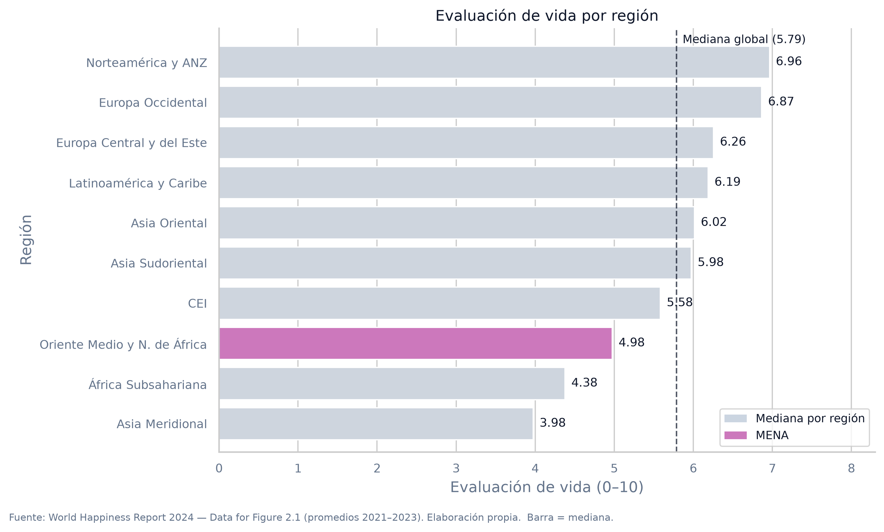
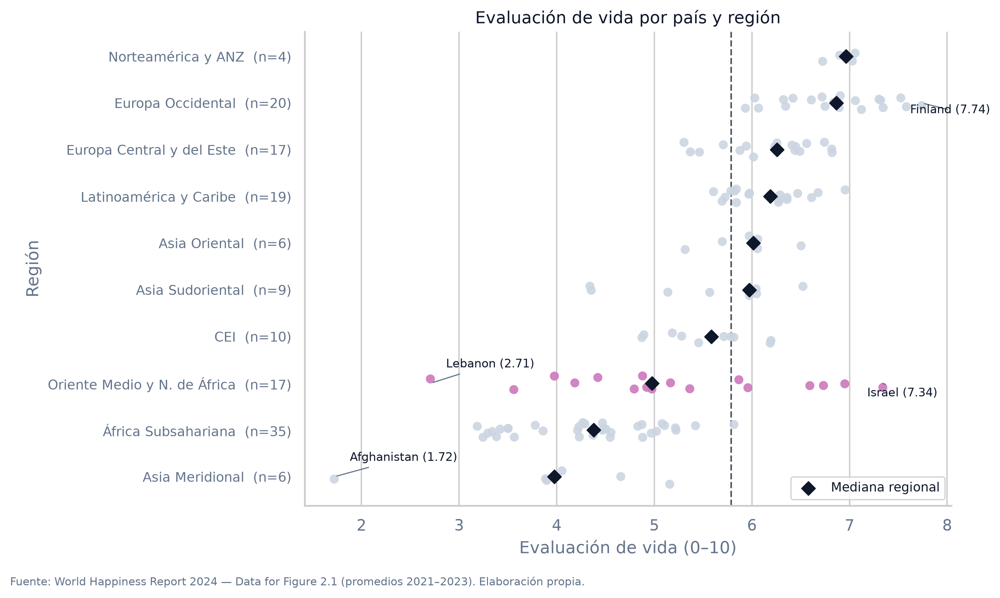
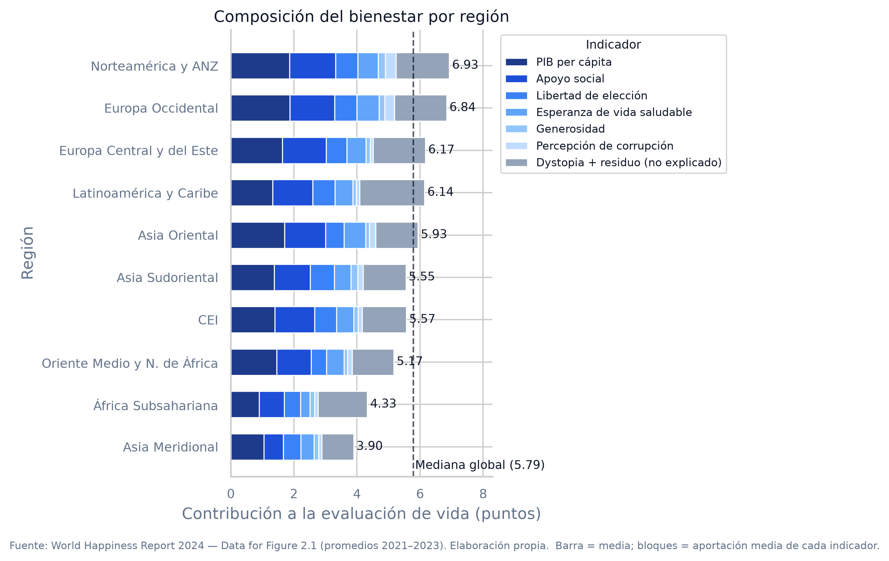

# Pregunta analítica y audiencia

**Pregunta analítica.** ¿Qué diferencias en los indicadores de bienestar se identifican entre las regiones oficiales del *World Happiness Report 2024*, y cuánta variación se observa dentro de cada región?

**Audiencia técnica.** Investigadores y analistas del equipo de estudios comparativos de bienestar de un organismo internacional, que necesita identificar cómo se distribuyen los indicadores **entre** las regiones oficiales y **dentro** de cada una, para orientar comparaciones regionales justificadas y futuras investigaciones. El análisis es reproducible: notebook completo, datos originales y dependencias documentadas.

# Conjunto de datos

| Elemento | Descripción |
|---|---|
| Fuente | `WHR24_Data_Figure_2.1.xls` — World Happiness Report 2024 (archivo oficial, *Data for Figure 2.1*) |
| Cobertura | 143 países. Cada valor del WHR 2024 resume en un solo dato por país las encuestas Gallup de **2021, 2022 y 2023** (así lo publica el archivo oficial); escala Cantril **0–10** |
| Variables | Evaluación de vida + intervalo de confianza del 95%; contribuciones de 6 factores (PIB, apoyo social, esperanza de vida, libertad, generosidad, corrupción) y bloque *Dystopia + residuo* — todas en puntos de escalera |
| Región | El archivo no trae la región: el equipo asignó cada país a una de las 10 regiones del WHR en el código y validó los conteos con la tabla 18 del *Statistical Appendix* 2024. **Único archivo de datos: el oficial** |
| Preparación | Verificación de integridad (contribuciones + residuo = ladder ✓), 3 países sin contribuciones excluidos solo de composición (Bahréin, Tayikistán, Palestina), renombrado de columnas y tabla de 143 × 14 |

**Nota inferencial.** Las contribuciones son componentes del modelo del WHR (relación parte–todo con la evaluación). Todas las relaciones mostradas son **asociaciones descriptivas, no causales**.

# Principales hallazgos

**1. El nivel difiere entre regiones…** Las medianas van de **6.96** (Norteamérica y ANZ) a **3.98** (Asia Meridional): casi 3 puntos en una escala de 10, con la mediana global en 5.79 y solo tres regiones por encima.

**2. …y también se diferencia la composición.** En todas las regiones PIB y apoyo social son los bloques más grandes; generosidad y corrupción aportan menos de 0.6 puntos juntos. **MENA tiene la menor contribución de libertad de la tabla (0.49)**. Entre **1.0 y 2.1 puntos** de cada región quedan fuera de los seis factores (*Dystopia + residuo*).

**3. La variación interna es tan relevante como la diferencia entre regiones.** El rango de países dentro de una región va de **0.33** (Norteamérica y ANZ) a **4.63** (MENA: de Líbano 2.71 a Israel 7.34); Asia Meridional, 3.44 (de Afganistán 1.72 a Nepal 5.16). **El promedio regional resume bien a las regiones homogéneas y engaña en las heterogéneas.**

**4. La asociación entre indicadores y evaluación depende del nivel de análisis.** Apoyo social y evaluación: **r = 0.81** entre los 140 países con datos, pero entre **0.14 y 0.83** dentro de cada región. El ranking de líderes cambia con el indicador: Finlandia (evaluación), Luxemburgo (PIB), Myanmar (generosidad), Hong Kong (esperanza de vida).

# Conclusiones y limitaciones

**Respuesta a la pregunta.** Las regiones difieren en *cuánto* valora su población su vida (hasta 3 puntos), en *de qué* se componen esas valoraciones y en *cuánta diversidad interna* ocultan (rangos de 0.33 a 4.63). Comparar regiones exige mirar siempre las tres cosas: nivel, composición y dispersión; descartar cualquiera de ellas lleva a lecturas parciales —el riesgo concreto es tratar un promedio regional como representativo de países que van de la mitad superior a la inferior del ranking mundial.

**Limitaciones.** El archivo publica contribuciones y no indicadores crudos; 3 países carecen de contribuciones (sin imputar); las regiones tienen entre 4 y 35 países; cada país tiene un solo valor (encuestas 2021–2023), sin evolución temporal; la agrupación regional fue construida por el equipo; no se infieren causalidades y parte de la varianza (1.0–2.1 puntos) queda fuera del modelo.

**Nuevas preguntas.** ¿Qué explica el bloque no asignado?, ¿se sostienen los patrones en la serie 2012–2023?, ¿cómo cambia la comparación con datos individuales por edad y género?

# Evidencia visual

**Nivel y dispersión.** Izquierda: mediana de evaluación de vida por región (barras) con mediana global. Derecha: cada país como punto, con mediana regional en rombo — la dispersión dentro de MENA y Asia Meridional contrasta con la compacta de Norteamérica y ANZ.

```{=html}
<div style="display:flex; gap:10px; margin:8px 0; page-break-inside: avoid;">
<div style="flex:1"></div>
<div style="flex:1"></div>
</div>
```

**Composición.** Cada barra es la evaluación media de la región, compuesta por la aportación media de cada factor (azules) y el bloque no explicado (gris): PIB y apoyo social dominan en todas; el residuo gris es comparable a varios indicadores juntos.



**Exploración interactiva.** El notebook y el archivo HTML entregados permiten cambiar el indicador del scatter (6 relaciones con su ajuste), filtrar por región y consultar rankings de países líderes/rezagados por los 7 indicadores.